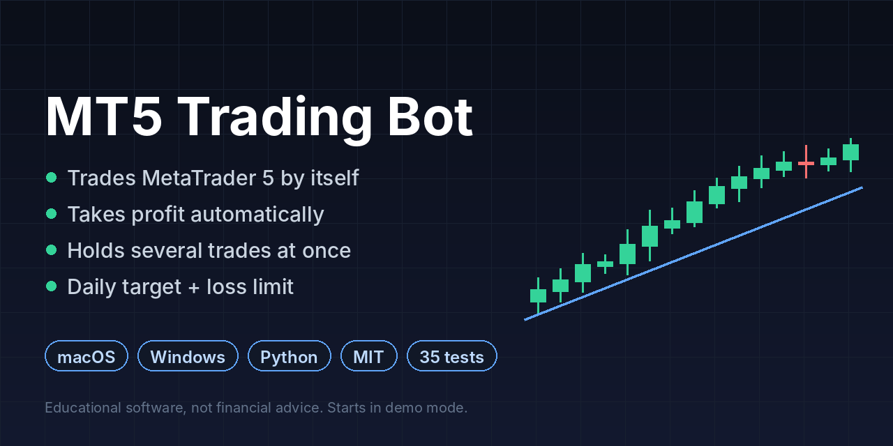
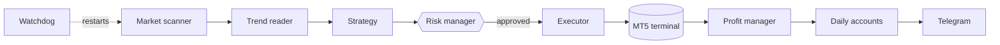

<p align="center">
  
</p>

<p align="center">
  <a href="https://github.com/ankitassoni4566-eng/mt5-trading-bot/actions/workflows/ci.yml"></a>
  <a href="LICENSE"></a>
  
  
  <a href="https://github.com/sponsors/ankitassoni4566-eng"></a>
</p>

<p align="center">
  <b>A free, open-source auto-trading bot for MetaTrader 5, on Mac and Windows.</b><br>
  It finds trades, sizes them safely, banks profit automatically and stops for the day when it hits its target.
</p>

---

## ✨ What it does

| | |
|---|---|
| 🤖 **Trades by itself** | Scans your markets every 30 s and enters when a strong trend pulls back |
| 💰 **Takes profit automatically** | Break-even at +1R, banks half at +1.5R, then trails the rest |
| 📊 **Several trades at once** | Up to 5 by default, spread across markets and currencies |
| 🎯 **Daily target with brakes** | Stops for the day at +1%, halts at −2%, and protects gains if the day turns |
| 📒 **Daily accounts** | A CSV and SQLite ledger of every trade, plus an end-of-day Telegram report |
| 📱 **Telegram remote control** | `/status`, `/positions`, `/pause`, and `/stop` (a kill switch) |
| 🔁 **Runs 24/7** | A watchdog restarts the bot if it crashes; Mac auto-start or Windows service |
| 🛡️ **Safe by default** | Demo-only until you flip two switches; stop-loss and take-profit held at the broker |

## 🧭 How it works



Every order must clear the **risk manager**, which checks the max open trades, the per-currency limit, the total risk cap and the lot size, before anything reaches MT5.

## 🚀 Try it in 2 minutes (no MT5 needed)

```bash
git clone https://github.com/ankitassoni4566-eng/mt5-trading-bot.git
cd mt5-trading-bot/mac          # or: cd mt5-trading-bot/windows
python3 -m venv .venv && source .venv/bin/activate     # Windows: .venv\Scripts\activate
pip install -r requirements-dev.txt
python -m pytest -q                       # 35 safety + logic tests
python run.py --backtest 90 --quiet       # 90 simulated days
```

```
──────── Backtest result ────────
Days simulated      : 91
Closed trades       : 233  (wins 117, losses 116, win rate 50%)
Most trades at once : 4
Max drawdown        : 6.77%
Days target hit     : 15
Days loss limit hit : 3
─────────────────────────────────
```

> These numbers come from **generated prices**. They prove the machinery works, not that it makes money. Backtest on your broker's real history: `python run.py --backtest 365 --data your_csv_folder`.

## 💻 Pick your version

| Folder | Runs on | Connects to MT5 through | Start here |
|---|---|---|---|
| [`mac/`](mac) | MacBook / iMac (Apple Silicon) | [SiliconMetaTrader5](https://pypi.org/project/siliconmetatrader5/) bridge | [`mac/MAC_SETUP.md`](mac/MAC_SETUP.md) |
| [`windows/`](windows) | Windows PC or VPS | Official `MetaTrader5` package | [`windows/README.md`](windows/README.md) |

Same trading logic, risk rules and tests in both. Only the connection and startup scripts differ.
The full design is in the [blueprint PDF](docs/MT5%20Bot%20Blueprint.pdf).

## ⚙️ Make it yours

Everything lives in `config.yaml`:

```yaml
risk:
  risk_per_trade_pct: 0.5     # lose at most 0.5% per trade
  max_open_trades: 5          # several trades at once
  max_trades_per_currency: 2
profit:
  breakeven_at_r: 1.0
  partial_close_at_r: 1.5
  trail_atr: 2.0
daily:
  target_pct: 1.0             # stop for the day at +1%
  max_loss_pct: 2.0           # halt at -2%
```

Want your own strategy? Add a class in `bot/strategies/` with a `generate()` method and register it. That's all.

## 🛡️ Safety built in

- **Demo by default.** It refuses to touch a real account unless `mode: live` **and** a confirm phrase are both set.
- **No duplicate orders.** Each signal is saved before sending, so a restart can't send it twice.
- **Closed candles only.** Signals can't flip while a candle is still forming.
- **Lot size rounds down.** It never risks more than planned.
- **Stops at the broker.** Your trades stay protected even if your computer or VPS dies.

## 🗺️ Roadmap

- [ ] News filter (pause around high-impact events)
- [ ] More strategies: breakout, mean-reversion
- [ ] Web dashboard for the daily accounts
- [ ] MQL5 Expert Advisor version (runs natively inside MT5)
- [ ] Docker image for Linux VPS

Want to help? See [CONTRIBUTING.md](CONTRIBUTING.md). Issues and pull requests are welcome.

## ❤️ Support the project

If this bot saved you time or taught you something:

- ⭐ **Star this repo.** It's free and helps others find it.
- 💖 **[Sponsor on GitHub](https://github.com/sponsors/ankitassoni4566-eng)**, or use the **Sponsor** button at the top of the page.
- 🔁 **Share it** with a trader or developer friend.

## ⚠️ Disclaimer

This is **educational software, not financial advice**. Trading leveraged products such as forex and CFDs carries a high risk of losing money. Past or simulated performance doesn't guarantee future results. Test on a demo account for weeks, and only ever trade money you can afford to lose. The authors accept no liability for trading losses.

The Mac version relies on the third-party SiliconMetaTrader5 bridge, which has its own licence (free for non-commercial use). MetaTrader is a trademark of MetaQuotes Ltd; this project isn't affiliated with or endorsed by MetaQuotes.

## 📄 License

[MIT](LICENSE): free to use, modify and share.
